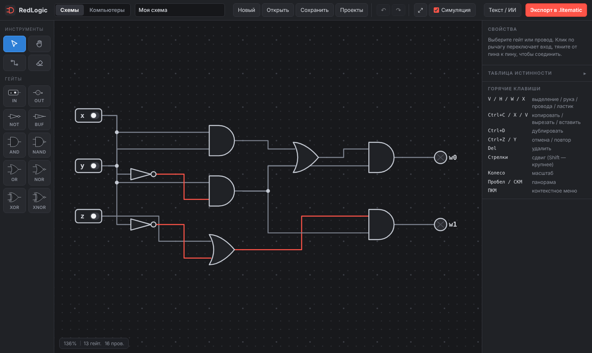
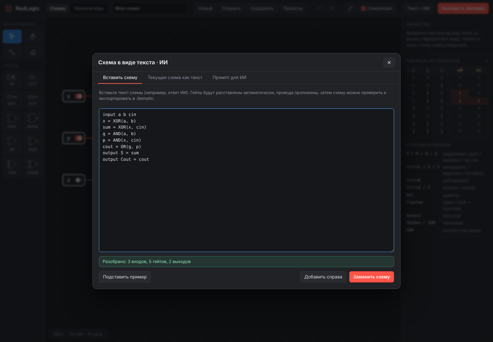
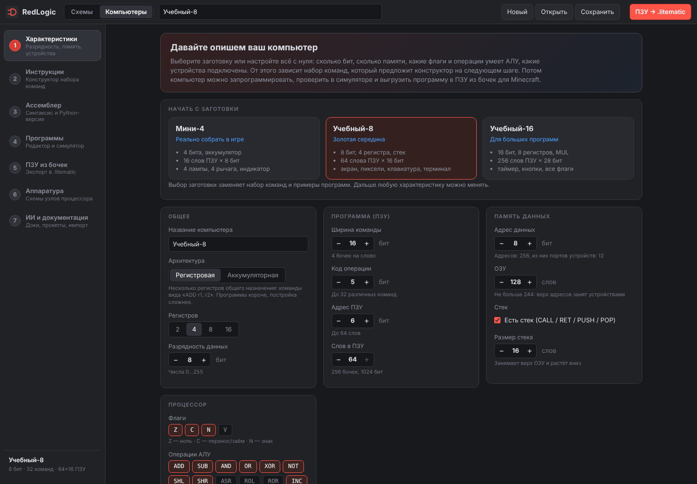
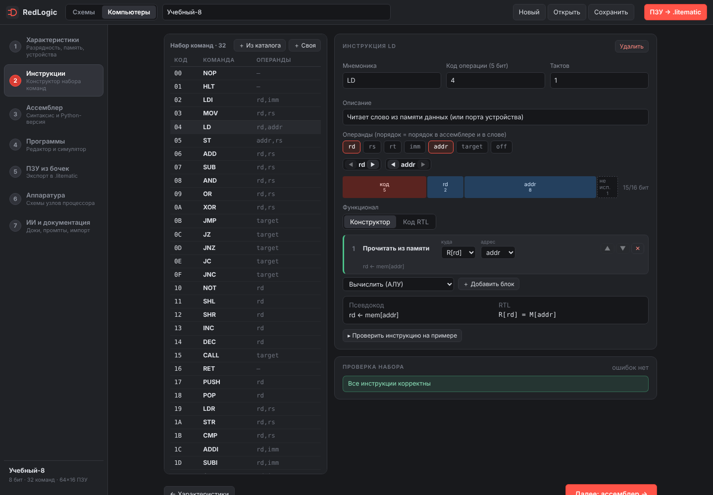
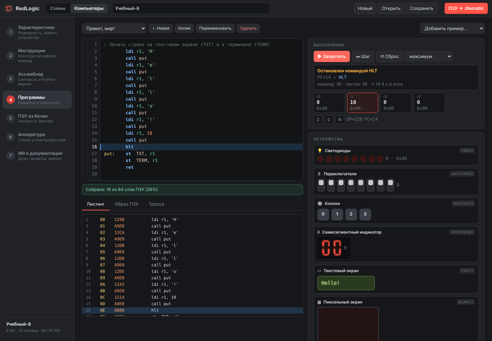
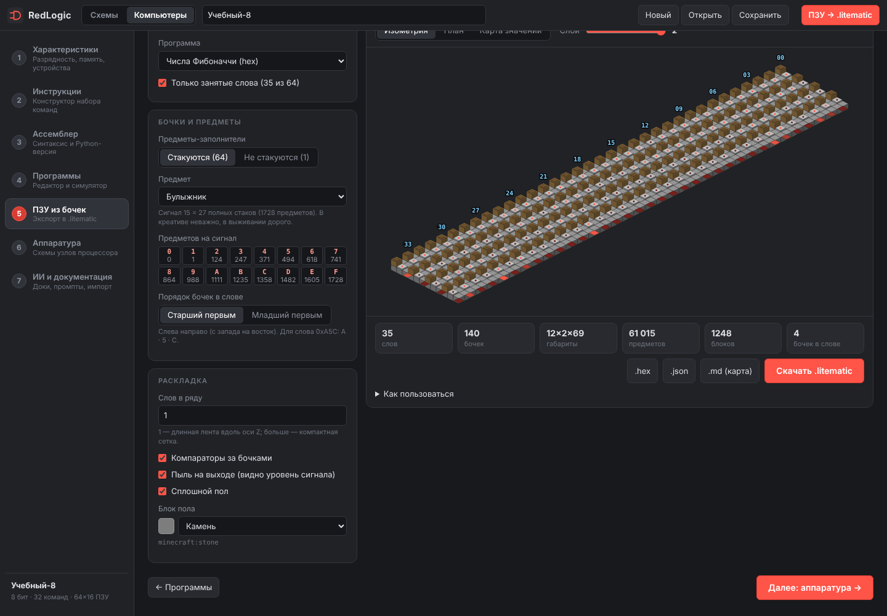
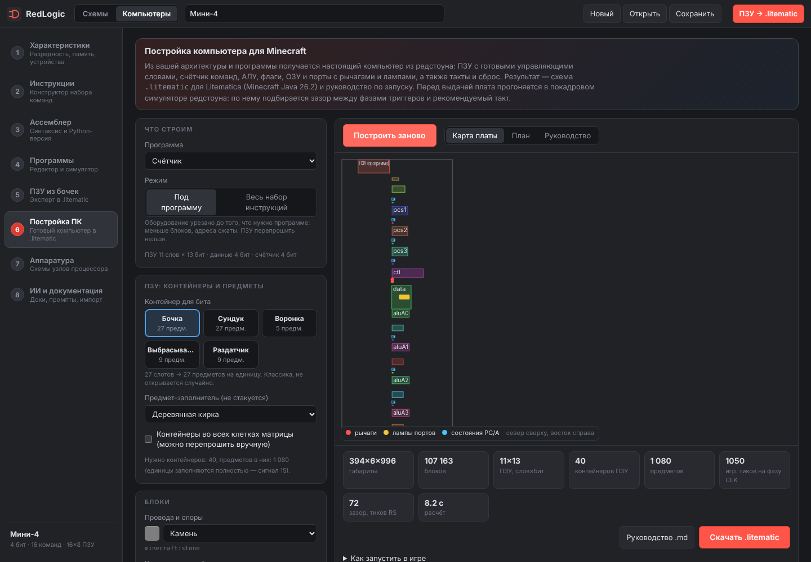
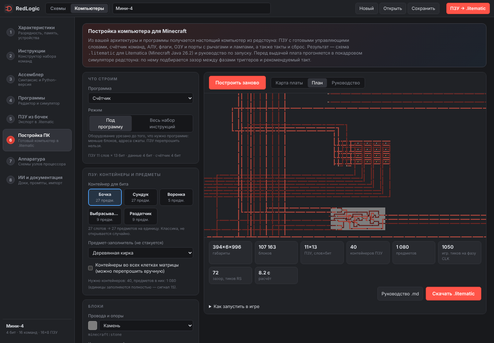

# RedLogic — редактор логических схем с экспортом в редстоун (`.litematic`)

Рисуете обычную логическую схему (гейты и провода, как в учебнике), а сайт сам строит из неё **компактную
редстоун-схему** для Minecraft Java Edition **26.2** и сохраняет её в формате **Litematica** (`.litematic`).



## Возможности

**Редактор**
- Тёмно-серый интерфейс, слева панель инструментов: выделение, рука, провода, ластик и гейты
  (вход-рычаг, выход-лампа, НЕ, повторитель, И, И-НЕ, ИЛИ, ИЛИ-НЕ, исключающее ИЛИ / НЕ; 2–4 входа).
- Гейты нарисованы стандартными символами, провода ортогональные, с узлами ветвления — как на учебной схеме.
- Выделение кликом, Shift/Ctrl и рамкой; перемещение, стрелки; контекстное меню (ПКМ) для гейта, провода и поля.
- Копировать / вырезать / вставить / дублировать (в том числе между вкладками), отмена и повтор.
- Настройка гейта: название, число входов, задержка повторителя, состояние рычага.
- Живая симуляция (клик по рычагу), таблица истинности, масштаб и панорама.
- Сохранение и загрузка проектов: файл `.redlogic.json`, список проектов в браузере, автосохранение.

**Экспорт**
- Размещение «как можно компактнее»: расстояния между гейтами подбираются автоматически (или задаются вручную).
- Пересечения проводов решаются мостами на 2–3 уровнях; повторители ставятся там, где сигнал затухает (каждые ≤ 15 блоков).
- Настройки: блок для проводов и пола, блок для гейтов (камень, бетон, шерсть, терракота… с выбором цвета),
  рычаг или кнопка на входах, подложка, максимальная высота мостов, шаг повторителей, название и автор.
- **Варианты реализации гейтов** — для каждого типа можно выбрать популярную схему (например, И через Де Моргана
  или через диодное ИЛИ; XOR на 5 факелах или как `a·¬b + ¬a·b`; ИЛИ диодное или на факелах).
- Предпросмотр: объёмный и по слоям, с подписями входов и выходов.
- Перед скачиванием схема **проверяется**: редстоун-симулятор прогоняет все комбинации входов и сравнивает с логикой.

**Текст вместо рисования.** Схему можно описать текстом (`input a b` / `s = XOR(a, b)` / `output sum = s`) — «Текст / ИИ»:
вставить ответ нейросети (гейты расставляются сами), скопировать текущую схему как текст или взять готовый промпт для ИИ.



## Компьютеры (отдельная вкладка)

Переключатель **Схемы | Компьютеры** вверху. Во вкладке «Компьютеры» — пошаговый конструктор собственного компьютера:

1. **Характеристики.** При первом заходе компьютер «спрашивает» параметры: заготовка (Мини-4, Учебный-8, Учебный-16) или свои:
   архитектура (регистровая/аккумуляторная), разрядность 2–16 бит, число регистров, ширина команды и код операции, размеры ПЗУ и ОЗУ,
   флаги (Z C N V), операции АЛУ, стек, такт и **устройства**: светодиоды, рычаги, кнопки, 7-сегментный индикатор, текстовый и
   пиксельный экраны, клавиатура, таймер, генератор случайных чисел, нотный блок, терминал. Устройства отображаются в памяти данных (порты).
2. **Инструкции** — конструктор: каталог функционала (фильтруется по характеристикам), блоки «вычислить / прочитать / записать /
   перейти / вызвать…» превращаются в **псевдокод** и исполняемый **RTL-код**; можно писать RTL вручную. Карта кодов операций, схема
   битов слова, проверка на примере («r0=5 → r0=6»), валидация.
3. **Ассемблер** строится по набору команд и существует в двух видах: встроенный (в браузере) и **Python-файл** (`assembler.py`:
   ассемблер, дизассемблер, эмулятор; можно править). Синтаксис одинаков — сверено тестами «Python ↔ TypeScript».
4. **Программы** — редактор (подсветка, номера строк, ошибки, точки останова), листинг, образ ПЗУ и **симулятор**: запуск, шаг,
   скорость, регистры, флаги, память, трасса и живые устройства.
5. **ПЗУ из бочек** — генератор `.litematic`: слово программы хранится в бочках по 4 бита, сила сигнала компаратора = значение.
   Настраиваются предметы (стакающиеся/нет), порядок бочек, раскладка, компараторы, пыль; экспорт `.hex`, `.json`, `.md` с картой адресов.
6. **Постройка ПК** — настоящий компьютер из редстоуна в `.litematic`: ПЗУ с готовыми управляющими словами (декодер «зашит» в
   ПЗУ), счётчик команд, АЛУ, флаги, ОЗУ с портами (рычаги на входе, лампы на выходе), такты, сброс, индикаторы. Плата **компактная**:
   узлы (карточки) плотно расставляются на плоскости (отжиг по длине связей), а провода идут **поверх** них в 3–4 слоях на сетке
   узлов с шагом 2 (параллельные провода разделены пустой клеткой, слои — опорными блоками), поэтому цепи не обходят карточки по
   земле; если разводка не получилась, берётся запасная раскладка колонкой. Готовая плата прогоняется в покадровом симуляторе
   редстоуна (самопроверка проводки), по замеру подбираются зазор между фазами триггеров и рекомендуемый такт. Настройки компонентов: контейнер ПЗУ (бочка, сундук, воронка, выбрасыватель, раздатчик) и предмет,
   матрица «только единицы» или «во всех клетках» (перепрошивка), режим «под программу» (урезанное оборудование) или «весь набор
   инструкций», материалы проводов и корпусов, реализации вентилей, тактирование (рычаг / автогенератор), индикаторы и лампы портов.
   Выдаются схема, руководство `.md` (координаты рычагов и ламп, содержимое ПЗУ, рекомендуемый такт), карта платы и план.
7. **Аппаратура** — генераторы схем для узлов процессора (дешифратор команд по вашему набору, дешифратор адреса, сумматор,
   сравнение, мультиплексор, регистр на защёлках) — открываются в редакторе схем.
8. **ИИ и документация** — документы `docs/ai/` (форматы JSON компьютера, RTL, ассемблер, нетлист) и промпты: «придумай процессор»,
   «напиши программу» (подставляет ваш набор команд, карту памяти, устройства), «составь схему». Импорт ответа ИИ с отчётом об ошибках
   и готовым запросом на исправление.

Автосохранение в браузере; файл компьютера `.rlcomputer.json` (кнопки «Сохранить» / «Открыть» вверху).

| Характеристики | Конструктор инструкций |
|---|---|
|  |  |
| **Симулятор с экраном** | **ПЗУ из бочек** |
|  |  |
| **Постройка ПК: карта платы** | **Постройка ПК: план** |
|  |  |

Подробно о форматах для ИИ — [`docs/ai/README.md`](docs/ai/README.md). Пример ПЗУ: [`docs/examples/rom_example.litematic`](docs/examples/rom_example.litematic).
Готовый компьютер («Счётчик», 4 бита, бочки): [`docs/examples/computer_counter.litematic`](docs/examples/computer_counter.litematic) и его руководство [`computer_counter.md`](docs/examples/computer_counter.md).
Готовый регистровый компьютер (4 бита, 4 регистра, ОЗУ, лампы): [`docs/examples/computer_regs.litematic`](docs/examples/computer_regs.litematic) и [`computer_regs.md`](docs/examples/computer_regs.md).

> **Границы постройки.** Физически строятся аккумуляторная и регистровая архитектуры (ПЗУ-программа, ОЗУ и порты); стек, `CALL/RET`,
> пропуски, относительные переходы, `MUL/NEG/ASR/ROL/ROR` пока только в симуляторе. Плата плоская и компактная и помещается в дальность прорисовки: 4-битный счётчик — около 215×275 блоков
> (раньше 360×1015), аккумуляторная с полным набором — около 350×320, регистровая с полным набором — около 410×420 (высота до 13 блоков).
> Один такт занимает десятки секунд: ускорьте мир командой `/tick rate 200` — задержки считаются в игровых тиках, поведение не меняется.

## Запуск

```bash
npm install
npm run dev          # разработка: http://localhost:5173
npm run build        # production-сборка в dist/
npm run build:single # один HTML-файл в dist-single/index.html (работает и по file://)
npm run single       # то же + копия в корень репозитория: RedLogic.html
npm run e2e          # сквозные проверки в браузере (нужен npm run preview на :4173)
npm test             # модульные тесты
```

**Одиночный файл:** [`RedLogic.html`](RedLogic.html) — всё приложение в одном HTML (без сервера и установки): скачайте и откройте в браузере. Постройка компьютера в нём идёт в основном потоке (страница на несколько секунд замирает).

Готовый `.litematic` положите в `.minecraft/schematics`, откройте Litematica (`M` → *Загрузить схему*).
Пример: [`docs/examples/example.litematic`](docs/examples/example.litematic) (схема из скриншота: `w0 = ¬x·y`, `w1 = ¬x·y·z`).

## Как это устроено

```
Редактор (гейты, провода) ──► модель Circuit ──► логический симулятор (эталон, таблица истинности)
                                    │
                                    ▼
          techmap: гейты → примитивы {НЕ, NOR, диодное ИЛИ, повторитель}   (выбор варианта гейта)
                                    │
                                    ▼
          размещение: колонки по глубине, ряды — изотоническая регрессия по барицентрам
                                    │
                                    ▼
          маршрутизация: 3D A* по воксельной сетке, провода — пыль на опорных блоках,
          мосты для пересечений, строгие правила изоляции цепей, повторители каждые ≤ 15 блоков
                                    │
                                    ▼
          RedstoneSim: правила пыли/факелов/повторителей/ламп из игры ──► сверка с логикой
                                    │
                                    ▼
                    .litematic (NBT + gzip, Version 6, DataVersion 4903)
```

Физический компьютер (`src/cpu/`): `plan.ts` (программа → строки ПЗУ и состав оборудования), `micro.ts` (управляющие слова и модель железа),
`hwnets.ts` + `macrolib.ts` (блоки логики из нетлистов, собираются тем же компилятором), `arrays.ts` / `dataarray.ts` (ПЗУ и ОЗУ из контейнеров и
защёлок), `place2d.ts` (двумерная расстановка карточек), `floor.ts` (разводка поверх узлов), `bus.ts` (запасная раскладка колонкой с детерминированной шиной), `computer.ts` (сборка платы), `timing.ts` (замер фаз замков и подбор такта в симуляторе `tick.ts`),
`computerExport.ts` (схема `.litematic` и руководство).

Ключевые файлы: `src/compiler/` (techmap, place, route, compile), `src/redstone/` (симулятор правил игры),
`src/export/` (NBT и Litematica, в т. ч. блок-сущности: содержимое бочек), `src/editor/` (холст, хранилище), `src/ui/` (панели и диалоги),
`src/model/netlist.ts` (текстовый формат схем), `src/computer/` (спецификация, RTL, набор команд, ассемблеры, симулятор, устройства,
ПЗУ из бочек, генераторы аппаратуры, промпты) и `src/computer/ui/` (шаги вкладки).

## Как проверено

1. **Тесты** (`npm test`): логика, компилятор, эталонные конструкции редстоуна, десятки случайных схем.
2. **Независимое чтение файла**: `.litematic` читается библиотекой Litemapy, блоки и свойства совпадают с источником.
3. **Настоящий сервер Minecraft 26.2** (`scripts/mc_verify.py`): схемы расставляются командами `setblock`,
   рычаги переключаются перебором, лампы сверяются с таблицей истинности, а записанные состояния пыли/факелов/
   повторителей сравниваются с тем, что насчитал игровой движок. Проверены все гейты, все варианты, 2–4 входа,
   случайные схемы и пример. Запуск: `npm run verify:mc` (нужны Java 25, `server.jar` 26.2, RCON на 25575).
4. **ПЗУ из бочек на настоящем сервере 26.2** (`scripts/mc_verify_rom.py`): файл читается Litemapy, блоки и предметы расставляются,
   сила сигнала за каждым компаратором сверяется со значением ниббла. Проверены обе раскладки, стакающиеся и нестакающиеся предметы
   и файл, скачанный из интерфейса.
5. **Компьютеры**: интерпретатор RTL и ассемблер сверены с независимым Python-эмулятором; документы `docs/ai/` проверяются тестами
   (примеры нетлистов и ассемблера, таблица RTL, JSON-пример); генераторы аппаратуры проверены перебором входов и компиляцией.
6. **Постройка ПК**: собранная плата прогоняется в покадровом симуляторе (`tests/cpu/computer.test.ts`) и сверяется с эмулятором после
   каждой инструкции: аккумуляторные (счётчик, сумма рычагов с лампами и портами, расширенный набор с флагами Z C N V, сдвигами и
   переходами, нестандартные варианты вентилей) и регистровые машины (файл регистров с двумя портами чтения, АЛУ, флаги, `LDR/STR`,
   `JR`). Управление и модель железа дополнительно проверены на тысячах случайных программ против эмулятора. Каждая собираемая плата
   перед выдачей проходит самопроверку на короткие замыкания между цепями шины (`src/cpu/netcheck.ts`). Готовый `.litematic` проверен и на **настоящем сервере 26.2** — аккумуляторные (счётчик, сумма рычагов с лампами, расширенный набор на 33 шага) и регистровые машины (регистры, память и порт; расширенный набор с флагами, `LDR/STR`, `JR` на 25 шагов) (`scripts/mc_verify_computer.py`:
   схема читается Litemapy, расставляется командами `setblock`, рычаг CLK переключается, а счётчик команд, аккумулятор, флаги, ОЗУ и лампы
   сверяются с эмулятором на каждом шаге).
7. **Браузер**: `scripts/e2e.mjs` и `scripts/e2e-computers.mjs` (Playwright) — расстановка, провода, перетаскивание, копирование,
   отмена, меню, сохранение/загрузка, экспорт; вкладка «Компьютеры» целиком (конструктор, симулятор, ПЗУ, импорт ИИ, нетлист);
   `scripts/e2e-build.mjs` — шаг «Постройка ПК» (настройки, постройка в воркере, карта/план/руководство, скачивание);
   `scripts/screenshots.mjs` — скриншоты в `docs/screenshots/`.

## Ограничения и планы

- Схемы с обратными связями (защёлки, триггеры, генераторы тактов) пока не экспортируются — в редакторе они считаются.
- Сигнал идёт слева направо; модули не поворачиваются. Входы NOR-блока — до 3, большие гейты собираются деревом.
- Проверка в Litematica на самом клиенте не автоматизирована: формат файла сверен с Litemapy, поведение — с сервером.
- ОЗУ и лампы портов после вставки схемы в игру в неопределённом состоянии (RESET их не очищает): программа должна записывать, прежде чем читать.
- Физическая постройка: аккумуляторная и регистровая архитектуры без стека, относительных переходов и `MUL/NEG/ASR/ROL/ROR`; такт медленный (см. выше); перепрошивка ПЗУ — вручную (режим «во всех клетках»).
- Схемы-защёлки из генератора аппаратуры можно смоделировать в редакторе, но в `.litematic` они пока не экспортируются (обратные связи).
- Далее: быстрее такт, стек и вызовы в железе.
